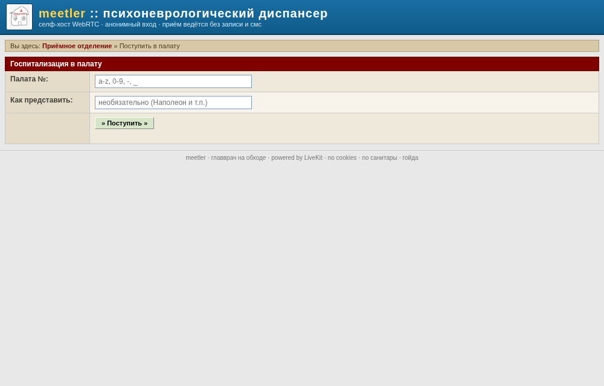
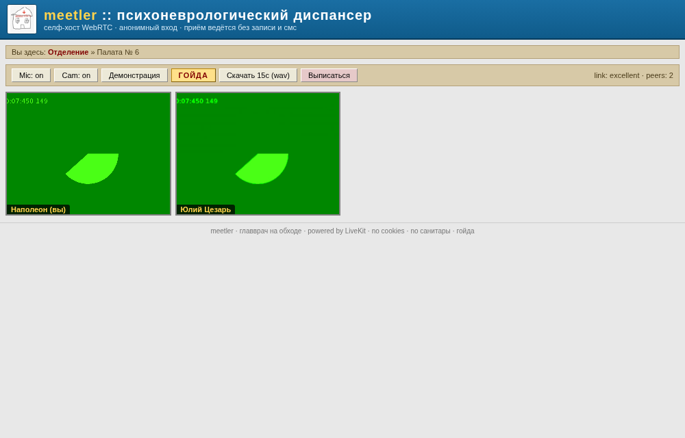
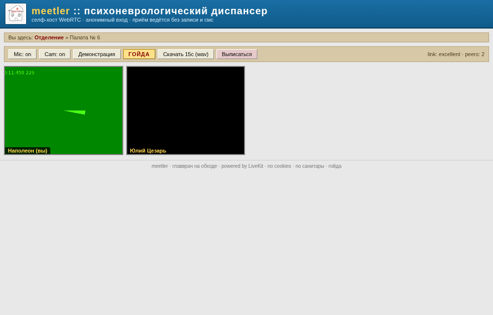

# meetler

Self-hosted видеоконференции на WebRTC в эстетике старого форума/дурдома. SFU —
[LiveKit](https://github.com/livekit/livekit) (Go, pion под капотом). Фокус:
минимальная задержка и коннект, который не рвётся. Вход анонимный — без аккаунтов,
по номеру «палаты».

Это не форк Jitsi. Та же архитектура (SFU + сигналинг + TURN + браузерный клиент),
но на Go-SFU с production-grade congestion control: TWCC send-side BWE, dynacast,
adaptive stream, агрессивный авто-fallback UDP → ICE/TCP → TURN/TLS.

## Скриншоты

Приёмное отделение (вход в палату):



Палата с участниками (зелёная рамка = говорит):



Выключенная камера → дефолтная аватарка:



## Фичи

- Анонимный вход, рандомный identity, без PII. Имя запоминается (localStorage,
  на каждый ввод) — не надо вводить заново при каждом визите.
- **Меню палат слева в конференции** — вертикальный список всех палат:
  смена палаты в 1 клик, без перезагрузки страницы и без повторного ввода ника
  (switchRoom: disconnect → cleanup → join в новую).
- Видео (simulcast off, 180p низкий битрейт — приоритет «пролезть всегда»).
- Аудио opus mono, DTX/RED off — минимум задержки и обработки.
- Зелёная подсветка говорящих (`ActiveSpeakersChanged`).
- Аватарка при выключенной камере / стоп-шеринге (mute видео ↔ аватарка, у всех).
- **Индивидуальная громкость** каждого участника (ползунок на тайле, только у
  себя). **Деструктив — по голосам**: кик участника, удаление звука/портрета И
  **закрытие палаты** срабатывают ТОЛЬКО когда проголосовали 3 РАЗНЫХ пациента (anti-griefing).
  Прогресс отражается цветом крестика (жёлтый→оранжевый→красный, бейдж N/3);
  исполняет сервер (`/api/rooms/<room>/votes`, дедуп по анонимному client-id).
  Кикнутый улетает на `/jail.html` с minecraft-анимацией поломки его тайла
  (трещины + разлёт, у всех синхронно через LiveKit data).
- **Тёмная тема (Solarized Dark)** — тумблер в правом верхнем углу (localStorage).
- **Звук приветствия палаты** — играет у всех при входе пациента; дефолтный
  (`/welcome.mp3`) кастомизируется на палату (`POST/DELETE /api/rooms/<room>/welcome`).
- **Галерея портретов** и **аптечка звуков** — теперь в самой палате (не на
  главной), у каждой палаты свои.
- **Персистентные палаты** — реестр на файловой системе
  (`ROOMS_DIR/<палата>/{sounds,avatars}`): палата живёт, пока кто-нибудь не
  закроет её (✕ в списке на главной — каскад: DeleteRoom выписывает участников,
  RemoveAll сносит звуки/портреты палаты). Палата регистрируется при первом
  входе; список = реестр ∪ живые комнаты SFU. Переживает рестарты.
- **Звуковая аптечка (soundboard)** — ЗВУКИ КОНКРЕТНОЙ ПАЛАТЫ: любой пациент
  заливает звук (до 2 МБ и 10 сек, mp3/ogg/wav/m4a/webm/opus), каждый становится
  кнопкой: нажатие слышит вся палата. Ползунок громкости — индивидуальный
  (только у себя, localStorage). Удалить звук может любой (✕ у кнопки).
  Всё проигрываемое — не длиннее 15 сек.
- **Галерея портретов** — ПОРТРЕТЫ КОНКРЕТНОЙ ПАЛАТЫ: любой заливает картинки
  (jpg/png/gif/webp, до 4 МБ), каждому пациенту достаётся случайная:
  детерминированный хеш sid по стабильному списку (все зрители видят одну и ту
  же, без сигналинга). Убрать лишний портрет может кто угодно (✕ в галерее).
  Пока галерея пуста — дефолтный набор аватарок `/dav/` (работает из коробки).
- **Скачать 15с** — кольцевой PCM-буфер микса комнаты → .wav (ровно 15с).
- Клик по шапке — выход в приёмное отделение (в корень).

> **Миграция со старой версии** (глобальные sounds/avatars): старые волюмы
> `sounds`/`avatars` больше не используются — данные теперь живут в `rooms`
> (`/data/rooms/<палата>/...`). Старые файлы можно разложить по палатам вручную:
> `docker run --rm -v hit-meet_rooms:/r -v hit-meet_sounds:/s alpine \
>  sh -c 'mkdir -p /r/general/sounds && cp /s/* /r/general/sounds/'` (комнату
> `general` потом создаст первый вошедший... или создай её входом с таким именем).
- Устойчивость: бесконечный reconnect, захват устройств с таймаутом (зависший
  getUserMedia не блокирует вход), fallback на TCP/TURN при любой проблеме UDP.

## Архитектура

```
браузер ──wss(443)──► nginx ──► LiveKit signaling (7880)
   │                    └──► token-svc (анонимный room-JWT)
   │
   └──RTP/UDP(50000-60000)──► LiveKit SFU   (напрямую, host-network)
   └──TURN/TLS(5349)────────► LiveKit TURN  (fallback за firewall)
```

- **livekit** — SFU + встроенный TURN. `network_mode: host` — UDP media идёт напрямую
  на публичный IP без Docker userland proxy (иначе ICE деградирует).
- **token-svc** — Go, выдаёт короткоживущий room-JWT со случайным `anon-<id>`.
  identity всегда серверный рандом — клиент не может выдать себя за другого.
- **nginx** — TLS, проксирует wss-сигналинг, token API, отдаёт статику.
- **redis** — состояние комнат/роутинг (нужен даже на одной ноде).

## Требования

- Публичный IP на хосте (прямой, без NAT перед ним — иначе см. раздел NAT).
- DNS A/AAAA `SITE_DOMAIN` → этот хост.
- Открытые порты (firewall / security group):
  - `443/tcp`, `80/tcp` — nginx (HTTPS + редирект с HTTP).
  - `50000-60000/udp` — RTP media.
  - `7881/tcp` — ICE-over-TCP fallback.
  - `5349/tcp` — TURN/TLS.
  - `30000-40000/udp` — TURN relay.
- Docker + docker compose, `bash`, `sed`, coreutils.
- TLS-сертификат и ключ для `SITE_DOMAIN` (и `TURN_DOMAIN`, если он отличается).

## Запуск

```bash
make keys          # сгенерить API keypair в .env
# отредактируй .env: SITE_DOMAIN, TURN_DOMAIN (обычно = SITE_DOMAIN)

mkdir -p certs
# Выпусти сертификат своим ACME-клиентом и установи полную цепочку и ключ:
install -m 0644 /path/to/fullchain.pem certs/turn.crt
install -m 0600 /path/to/privkey.pem certs/turn.key
# в .env: TURN_ENABLED=true
make up
```

Открой `https://SITE_DOMAIN`, введи комнату → ты в конференции.

В Compose nginx использует готовые сертификаты из `certs/`; их выпуск и обновление
выполняет внешний ACME-клиент. В NixOS сертификатами управляет `security.acme`.
Для локальной разработки без TLS:
```bash
docker compose -f docker-compose.yml -f docker-compose.dev.yml up -d --build
```
Открой `http://localhost:8088`.

## Tuned-настройки (что и зачем)

Сервер (`livekit/livekit.yaml.template`):
- `congestion_control.use_send_side_bwe: true` — SFU оценивает пропускную по TWCC и
  режет/переключает слои **до** потерь. Это и есть "минимизация задержки" на практике.
- `allow_tcp_fallback` + `tcp_fallback_rtt_threshold: 150` + `allow_udp_unstable_fallback`
  — миграция лоссёвого UDP на ICE/TCP или TURN/TLS без реконнекта.
- `turn` TLS/5349 — проходит сквозь корпоративные firewall (~50% "стабильности" за NAT).
- `room.playout_delay.min: 0` — минимальный буфер, растёт только при джиттере.
- `audio/red` + `active_red_encoding` — FEC голоса, скрывает потери пакетов.

Клиент (`web/app.js`):
- `simulcast: true` c 3 слоями (180p/360p/720p).
- `adaptiveStream` — клиент просит слой под размер тайла.
- `dynacast` — SFU не гоняет неиспользуемые слои.
- `dtx` + `red` на аудио.

## Анонимность

- Нет аккаунтов/IdP/email. `identity` = серверный `anon-<rand>`.
- Токен ограничен одной комнатой + TTL (`TOKEN_TTL`).
- В логах нет PII. Хочешь строже — выключи логи token-svc, сократи TTL.
- E2EE (сервер не видит медиа) не включён — это клиентский флаг `livekit-client`
  (insertable streams). Можно добавить позже, см. LiveKit E2EE docs.

## Если хост за NAT (OpenStack floating IP, облако)

`use_external_ip: true` в конфиге определяет публичный IP через STUN. Если self-ping
не проходит (security group не пускает трафик самому себе) — в `livekit.yaml.template`:
- выстави `node_ip: <floating-ip>` и `use_external_ip: false`, либо
- добавь `skip_external_ip_validation: true`.
Floating IP должен 1:1 мапиться на порт инстанса, security group — открыть UDP range.

## Ротация TLS-серта

После обновления сертификата внешним ACME-клиентом замени `certs/turn.crt`
(полная цепочка) и `certs/turn.key`, затем перезапусти nginx и TURN:
```bash
docker compose restart nginx livekit
```

## Observability

LiveKit отдаёт Prometheus-метрики на `:6789/metrics` (host-network). Скрейпь своим
Prometheus/VictoriaMetrics. Логи структурные (JSON) → VictoriaLogs.

## Telegram-мост (tgbridge)

Бот, который транслирует в палату пересланные ему медиа и озвучивает текст.

- Пересылаешь боту **голосовое / аудио / видео / видео-кружок** → проигрывается у
  всех в палате (ffmpeg транскод: аудио→opus, видео→vp8+opus). Лимит: **10 сек**
  на запись, всё проигрываемое — **не длиннее 15 сек** (обрезается).
- **`/tts <текст>`** — явная озвучка текста (piper TTS), работает и в группах
  без упоминания.
- **`/tovoice`** в реплае на сообщение с медиа (голосовое/аудио/видео/музыка
  документом) — проиграть это медиа в палате.
- Текст с **@упоминанием бота** (в личке также с **#палатой**) → озвучка через
  piper (TTS).
- Палата (приоритет): `#6` или `/palata 6` в сообщении → сохранённая командой
  `/palata 6` → `DEFAULT_PALATA`. `/palata` без аргумента — показать текущую.
- Команды: `/help`, `/start`, `/palata`, `/tts`, `/tovoice` — зарегистрированы
  в меню Telegram (кнопка «/» рядом с полем ввода).

**Группы:** по умолчанию у ботов включен privacy mode — рядовой бот в группе
получает только команды, упоминания и реплаи, медиа без упоминания до него
**не доставляется вовсе**. Чтобы медиа работало в группе, нужно одно из двух:
- сделать бота **админом группы** (админы видят всё);
- или `@BotFather → /setprivacy → выбрать бота → Disable`.

В группах бот реагирует только на **адресованные** ему сообщения: @упоминание,
реплай на его сообщение или `#палата` в подписи к медиа — каждое голосовое
чата он не перехватывает. Команды понимают @суффикс (`/palata@bot 6`), команды
с чужим @суффиксом игнорируются. При добавлении в группу бот сам пишет
подсказку. Сообщения других ботов игнорируются (anti-loop), анонимные админы
(GroupAnonymousBot) — работают.

Бот — headless-participant LiveKit (identity `tgbridge`), держит `LIVEKIT_API_KEY/
SECRET`, подключается к палате по `ws://127.0.0.1:7880`, льёт и отключается по idle.

docker-compose (профиль `telegram`, не поднимается по умолчанию):
```bash
# в .env: TELEGRAM_BOT_TOKEN=...  (ключи livekit уже есть)
docker compose --profile telegram up -d --build
```
TTS: смонтируй piper .onnx модель и задай `PIPER_MODEL=/models/ru.onnx` (без неё
озвучка текста выключена, медиа работает).

NixOS:
```nix
services.meetler.telegram = {
  enable = true;
  environmentFile = "/run/secrets/tg.env";   # TELEGRAM_BOT_TOKEN=...
  # Голос piper: авто-скачивание русской модели (dmitri | irina | ruslan)
  piperVoice = "dmitri";
  # ...или своя модель (взаимоисключимо с piperVoice):
  # piperModel = "/var/lib/piper/ru.onnx";   # null = TTS off
};
```

## Деплой через NixOS (альтернатива docker-compose)

Flake экспортирует `nixosModules.default`, который оборачивает официальный
`services.livekit` с tuned-настройками + token-svc (systemd, DynamicUser) +
nginx + ACME + firewall.

```nix
# flake.nix твоей системы (репозиторий на GitHub пока называется hit-meet)
{
  inputs.meetler.url = "github:71g3pf4c3/hit-meet";
  outputs = { nixpkgs, meetler, ... }: {
    nixosConfigurations.meet = nixpkgs.lib.nixosSystem {
      system = "x86_64-linux";
      modules = [
        meetler.nixosModules.default
        {
          services.meetler = {
            enable = true;
            domain = "meet.example.com";
            acmeEmail = "admin@example.com";
            livekitKeyFile = "/run/secrets/livekit-keys.yaml";
            tokenEnvironmentFile = "/run/secrets/token.env";
            nodeIp = "203.0.113.10";         # floating IP для облака/NAT
          };
        }
      ];
    };
  };
}
```

Секреты (вне nix store):
- `livekitKeyFile` — формат `<key>: <secret>` (`livekit-server generate-keys`).
- `tokenEnvironmentFile` — `LIVEKIT_API_KEY=...` и `LIVEKIT_API_SECRET=...`,
  та же пара key/secret. Клади через sops-nix / agenix / Vault, не в git.

nginx настраивается с `proxyWebsockets` для wss-сигналинга и 24h read/send timeout
на `/rtc`. ACME централизован в `security.acme`, сертификат доступен nginx
и встроенному TURN LiveKit через группу `nginx`.

На первом деплое (серта ещё нет) можно `services.meetler.enableTurn = false`,
после выписки серта — снять флаг и пересобрать.

Dev-shell: `nix develop` (go, gopls, livekit, livekit-cli, nginx).

Примечание: nixpkgs тянет livekit из своего пина (может быть чуть старее docker-пина
v1.13.10 — tuned-поля конфига идентичны, API совместим).

## Лимиты

- Один инстанс LiveKit. Для кластера (много нод, общий redis) — см. LiveKit distributed
  deployment; `redis` уже в стеке.
- `max_participants` per-room навязывается через RoomService CreateRoom — token-svc
  сейчас выдаёт токен на auto-create комнату; жёсткий лимит — TODO (создавать комнату
  с лимитом до выдачи первого токена).
- Recording/SIP — отдельные компоненты LiveKit (egress/SIP), в этот стек не входят.
